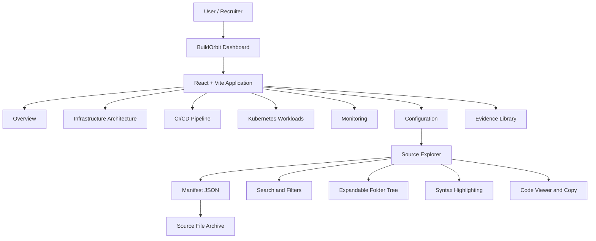
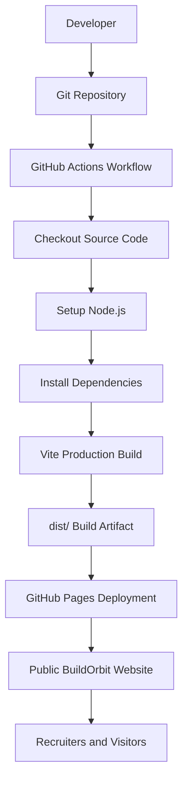
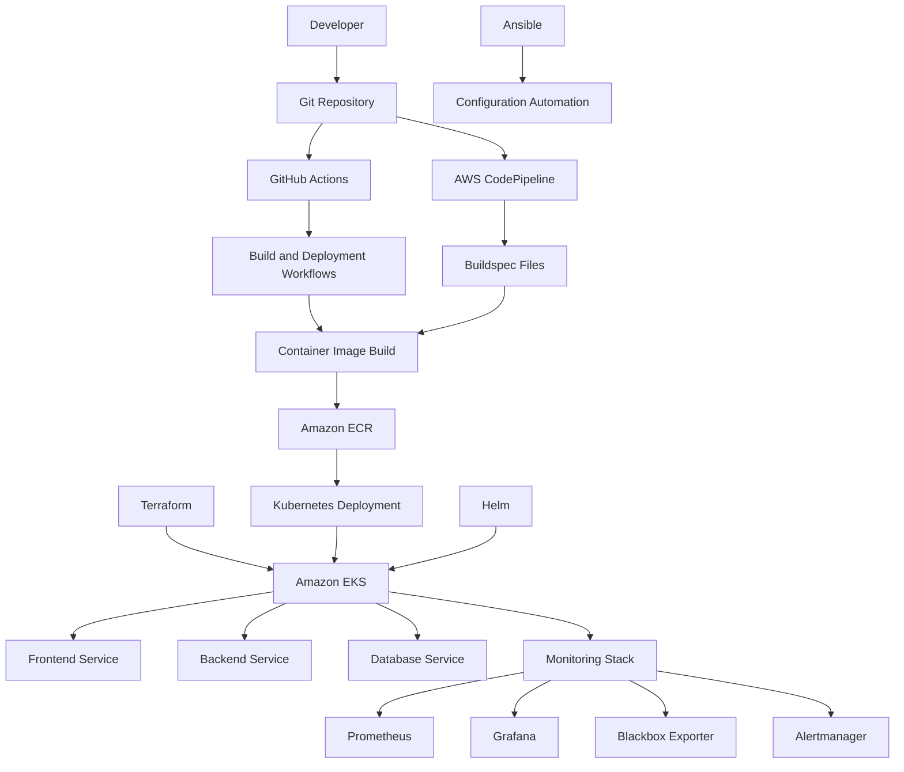

# BuildOrbit

### Build. Orchestrate. Observe.

**BuildOrbit** is an interactive DevOps engineering dashboard that presents a cloud-native application deployment project through a centralized, evidence-oriented interface. It brings together infrastructure architecture, CI/CD workflows, Kubernetes workloads, monitoring components, configuration files, and source code exploration.

<p align="center">
  <a href="https://gitwithkomal.github.io/BuildOrbit/">Live Application</a> ·
  <a href="https://github.com/GitWithKomal/BuildOrbit">Source Code</a> ·
  <a href="https://github.com/GitWithKomal/BuildOrbit/actions">GitHub Actions</a>
</p>

---

## Project Overview

BuildOrbit provides a visual walkthrough of a DevOps project, helping developers and reviewers understand how application code, containerization, infrastructure automation, deployment pipelines, Kubernetes, and monitoring fit together.

Instead of navigating through multiple folders and configuration files, users can explore the project through an interactive dashboard.

## Architecture

### 1. BuildOrbit Application Architecture

This diagram represents the dashboard's application structure and its source-code exploration functionality.



### 2. BuildOrbit Deployment Architecture

This diagram shows how the BuildOrbit frontend is built and published.



### 3. DevOps Project Delivery Architecture

The following conceptual diagram represents the technologies and deployment workflow documented in the archived capstone source.



*The DevOps architecture represents the documented capstone workflow, not infrastructure currently running in AWS.*

---

## Key Features

- **Interactive Dashboard:** Centralized view of the project's DevOps components.
- **Architecture Visualization:** Understand application delivery and infrastructure workflows.
- **CI/CD Pipeline View:** Explore build, containerization, and deployment stages.
- **Kubernetes Overview:** Review cluster components, workloads, and deployment configuration.
- **Monitoring Overview:** Explore Prometheus, Grafana, Blackbox Exporter, and Alertmanager.
- **Configuration Explorer:** Navigate infrastructure and deployment configuration sections.
- **Source Explorer:** Browse archived source code through an expandable nested folder structure.
- **Code Viewer:** Search files, filter by category, view syntax-highlighted code, and copy file contents.
- **Responsive Interface:** Designed for desktop and mobile viewing.

## Technology Stack

### BuildOrbit Application

<p align="center">
  
  
  
  
  
  
  
</p>

### Development and Deployment

<p align="center">
  
  
  
  
  
  
</p>

### DevOps Technologies Demonstrated in the Archived Capstone

<p align="center">
  
  
  
  
  
  
  
  
  
  
  
  
  
  
  
  
  
  
  
  
  
</p>

## Source Code Explorer

The dashboard includes a dedicated Source Explorer for browsing the archived capstone project files.

It supports:

- Nested directory navigation.
- Expandable and collapsible folders.
- File search and category filters.
- Syntax-highlighted source code.
- File selection and code viewing.
- Copying file contents.

### Source Archive Structure

```text
public/
└── source-full/
    ├── manifest.json
    ├── codepipeline/
    ├── kubernetes-deployment/
    ├── kubernetes-monitoring/
    ├── multi-service-app/
    ├── terraform-codepipeline/
    ├── terraform-eks/
    └── workflow-archive/
```

## Run Locally

### Prerequisites

- Node.js
- npm
- Git

### Installation

```bash
git clone https://github.com/GitWithKomal/BuildOrbit.git
cd BuildOrbit
npm install
npm run dev
```

Open the local URL provided by Vite, usually:

```text
http://localhost:5173
```

### Production Build

```bash
npm run build
```

The production output is generated in the `dist/` directory.

## Project Structure

```text
BuildOrbit/
├── .github/
│   └── workflows/
│       └── deploy.yml
├── public/
│   └── source-full/
│       ├── manifest.json
│       ├── codepipeline/
│       ├── kubernetes-deployment/
│       ├── kubernetes-monitoring/
│       ├── multi-service-app/
│       ├── terraform-codepipeline/
│       ├── terraform-eks/
│       └── workflow-archive/
├── src/
│   ├── SourceExplorer.jsx
│   ├── main.jsx
│   ├── sourceExplorer.css
│   └── style.css
├── index.html
├── vite.config.js
├── package.json
├── package-lock.json
├── README.md
└── .gitignore
```

## Deployment

BuildOrbit is deployed using **GitHub Pages** with an automated GitHub Actions workflow.

On every push to the `main` branch:

1. GitHub Actions checks out the repository.
2. Node.js dependencies are installed.
3. Vite builds the production application.
4. The generated `dist/` directory is uploaded as a Pages artifact.
5. GitHub Pages publishes the application.

**Live URL:** https://gitwithkomal.github.io/BuildOrbit/

**Deployment Workflow:** https://github.com/GitWithKomal/BuildOrbit/actions

## Important Project Notes

- The AWS EKS environment used during the capstone lab was destroyed after the exercise to avoid ongoing cloud charges.
- BuildOrbit is a project showcase, not a live AWS management console.
- Dashboard resource metrics that use illustrative sample values are demo data, not real-time cluster telemetry.
- Archived source files are provided for exploration and learning. Sensitive credentials and environment-specific state files should not be committed.
- The architecture diagrams explain the documented project workflow; they should not be interpreted as proof of currently running infrastructure.

## Author

**Komal Nimje**

Software Engineer | DevOps

- GitHub: https://github.com/GitWithKomal
- Portfolio: https://komal-portfolio-nine-alpha.vercel.app

---

<p align="center">
  <strong>Build. Orchestrate. Observe.</strong><br/>
  Exploring the engineering behind cloud-native applications and DevOps automation.
</p>