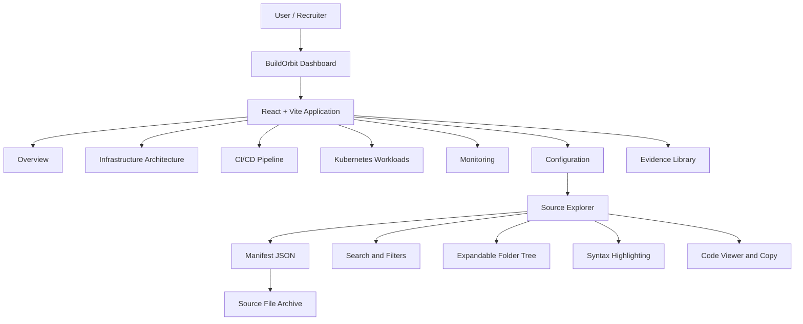
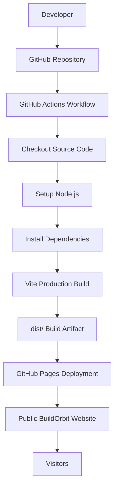
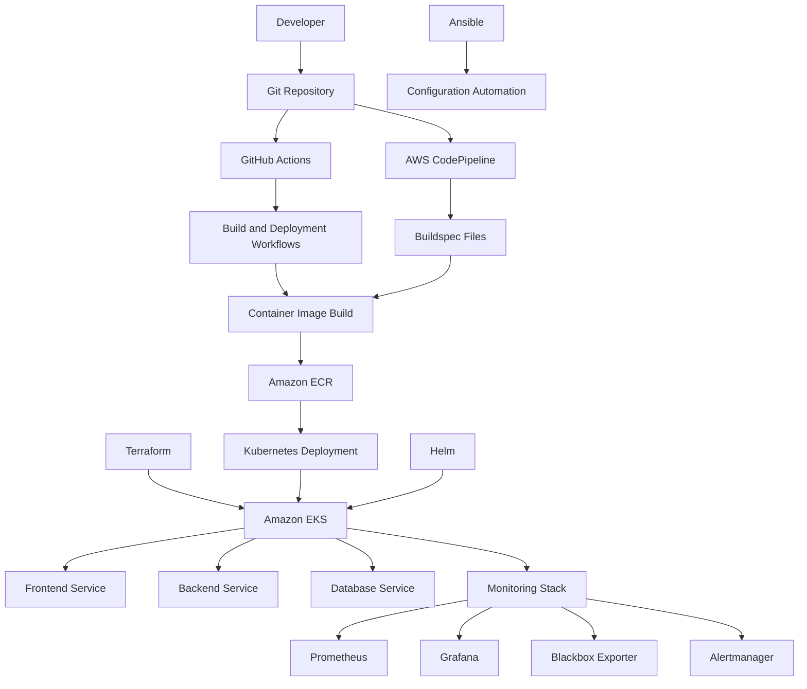

# BuildOrbit | DevOps Engineering Dashboard

<p align="center">
  <a href="https://gitwithkomal.github.io/BuildOrbit/">🌐 Live Demo</a> |
  <a href="https://github.com/GitWithKomal/BuildOrbit">📂 Source Code</a> |
  <a href="https://github.com/GitWithKomal/BuildOrbit/actions">⚙️ CI/CD Workflows</a>
</p>

**Building, visualizing, and exploring cloud-native infrastructure, CI/CD pipelines, Kubernetes deployments, and DevOps automation.**

<p align="center">
  <a href="https://gitwithkomal.github.io/BuildOrbit/"><strong>Live Application</strong></a> ·
  <a href="https://github.com/GitWithKomal/BuildOrbit"><strong>Source Code</strong></a> ·
  <a href="https://github.com/GitWithKomal/BuildOrbit/actions"><strong>GitHub Actions</strong></a>
</p>

<p align="center">
  
  
  
  
  
  
  
  
  
  
  
</p>

---

## Project Overview

BuildOrbit is an interactive DevOps engineering dashboard designed to present a cloud-native application deployment project through a centralized, evidence-oriented interface.

It brings together infrastructure architecture, CI/CD workflows, Kubernetes workloads, monitoring components, configuration files, and source-code exploration.

Instead of navigating through multiple folders and configuration files, visitors can explore the documented project through an interactive dashboard.

## Architecture

### 1. BuildOrbit Application Architecture

The dashboard is built with React and provides separate sections for exploring the project's architecture, workflows, Kubernetes configuration, monitoring concepts, and source files.



### 2. BuildOrbit Deployment Architecture

BuildOrbit is built and published using GitHub Actions and GitHub Pages.



### 3. Documented DevOps Capstone Architecture

The following diagram represents the DevOps workflow documented in the archived capstone project files.



*This is a representation of the documented capstone workflow. It does not indicate that the AWS infrastructure is currently running.*

## Key Features

- **Interactive Dashboard:** Centralized interface for exploring the documented DevOps project.
- **Infrastructure Architecture:** Visual representation of the application and infrastructure workflow.
- **CI/CD Pipeline:** Explore the documented build and deployment process.
- **Kubernetes Overview:** Review Kubernetes workloads and deployment configurations.
- **Monitoring Overview:** Explore the documented Prometheus, Grafana, Blackbox Exporter, and Alertmanager components.
- **Configuration Explorer:** Navigate the archived infrastructure and deployment configuration files.
- **Source Explorer:** Browse files through a nested, expandable folder structure.
- **Search and Filters:** Find source files using search and category filters.
- **Syntax Highlighting:** Read configuration and source files with syntax highlighting.
- **Code Viewer:** Select files, inspect their contents, and copy code.
- **Responsive Interface:** Explore the dashboard across different screen sizes.

## Technology Stack

### 1. BuildOrbit Application

Technologies used to build the dashboard itself.

<p align="center">
  
  
  
  
  
  
  
</p>

### 2. Development and Deployment

Tools used for source control, dependency management, CI/CD, and publishing BuildOrbit.

<p align="center">
  
  
  
  
  
</p>

### 3. DevOps Technologies Documented in the Archived Capstone

The following technologies appear in the archived capstone configurations and project documentation. They are separate from the technologies used to build the BuildOrbit dashboard.

<p align="center">
  
  
  
  
  
  
  
  
  
  
  
  
  
  
  
  
  
  
</p>

## Source Code Explorer

BuildOrbit includes a source-code explorer that makes the archived capstone files easier to navigate.

### Explorer Capabilities

- Nested folder and file navigation.
- Expandable and collapsible directories.
- Search across the available source files.
- Category-based filtering.
- Syntax-highlighted code display.
- File selection and content viewing.
- Copy code directly from the viewer.

### Archived Source Directory

```text
public/
└── source-full/
    ├── manifest.json
    ├── codepipeline/
    ├── kubernetes-deployment/
    ├── kubernetes-monitoring/
    ├── multi-service-app/
    ├── terraform-codepipeline/
    ├── terraform-eks/
    └── workflow-archive/
```

The explorer uses `manifest.json` to organize and load the archived files.

## Run Locally

### Prerequisites

- Node.js
- npm
- Git

### Installation

Clone the repository:

```bash
git clone https://github.com/GitWithKomal/BuildOrbit.git
```

Navigate to the project directory:

```bash
cd BuildOrbit
```

Install dependencies:

```bash
npm install
```

Start the development server:

```bash
npm run dev
```

Open the local URL displayed by Vite, usually:

```text
http://localhost:5173
```

### Production Build

Generate the production build:

```bash
npm run build
```

The generated production files are available in the `dist/` directory.

## Project Structure

```text
BuildOrbit/
├── .github/
│   └── workflows/
│       └── deploy.yml
├── public/
│   └── source-full/
│       ├── manifest.json
│       ├── codepipeline/
│       ├── kubernetes-deployment/
│       ├── kubernetes-monitoring/
│       ├── multi-service-app/
│       ├── terraform-codepipeline/
│       ├── terraform-eks/
│       └── workflow-archive/
├── src/
│   ├── SourceExplorer.jsx
│   ├── main.jsx
│   ├── sourceExplorer.css
│   └── style.css
├── index.html
├── vite.config.js
├── package.json
├── package-lock.json
├── README.md
└── .gitignore
```

## CI/CD and Deployment

BuildOrbit is deployed to GitHub Pages using GitHub Actions.

### Deployment Workflow

1. A push to the `main` branch triggers the workflow.
2. GitHub Actions checks out the repository.
3. Node.js is configured.
4. Dependencies are installed using `npm ci`.
5. Vite generates the production build using `npm run build`.
6. The `dist/` directory is uploaded as a Pages artifact.
7. The artifact is deployed to GitHub Pages.

The workflow also supports manual execution through `workflow_dispatch`.

**Deployment Links**

- [Live Application](https://gitwithkomal.github.io/BuildOrbit/)
- [GitHub Repository](https://github.com/GitWithKomal/BuildOrbit)
- [GitHub Actions Runs](https://github.com/GitWithKomal/BuildOrbit/actions)

## Important Project Notes

- BuildOrbit is a DevOps project showcase and source-exploration dashboard, not a live AWS management console.
- The AWS EKS environment used during the capstone lab was destroyed after the exercise to avoid ongoing cloud charges.
- The archived capstone architecture represents the documented workflow and should not be interpreted as currently running AWS infrastructure.
- Any illustrative dashboard metrics are sample/demo values, not live Kubernetes or cloud telemetry.
- Archived configuration files are provided for exploration and learning. Credentials, private keys, Terraform state files, and other sensitive artifacts are excluded or sanitized.
- The application deployment to GitHub Pages is separate from the archived AWS/EKS capstone workflow.

## Author

**Komal Nimje**  
Software Engineer | DevOps

- [GitHub](https://github.com/GitWithKomal)
- [Portfolio](https://komal-portfolio-nine-alpha.vercel.app)
- [BuildOrbit Live Demo](https://gitwithkomal.github.io/BuildOrbit/)

<p align="center">
  <strong>Build. Orchestrate. Observe.</strong>
</p>